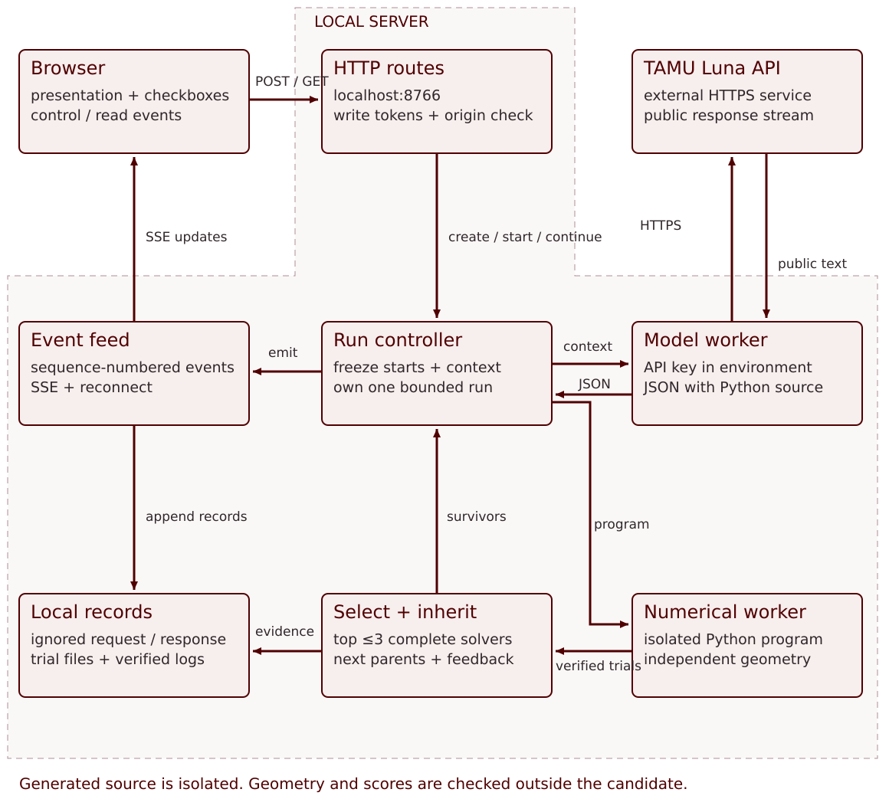

# Architecture and data flow of the circle-packing classroom

One loopback Python server serves every teaching view and owns a single active
packing run. The problem is AlphaEvolve’s unit-square sum-of-radii task for
N=26 or N=32. The model is TAMU Luna. Our local controller and initial numerical
methods are classroom implementations, not the unpublished AlphaEvolve engine.

{width=95%}

## Ownership and modules

| Module | Responsibility |
| --- | --- |
| server.py | Loopback HTTP, tokens/origin checks, routes, SSE and presentation preview |
| packing_controller.py | Run state, programs, banks, trials, requests, selection, Stop and replay |
| packing.py | Mathematical contract, seeded starts, source identity, independent geometry/score |
| packing_profile.json | Circle counts, trial/call/run limits and numerical-mode defaults |
| packing_programs/ | Three disclosed initial source programs |
| packing_sandbox.py | Mandatory Bubblewrap runtime isolation and availability check |
| packing_worker.py | Execute solve; provide fixed-center radius LP and progress reporter |
| model_worker.py | One bounded tool-free provider request; project public response stream |
| settings.py | Read ignored local configuration; bind credentials to the correct provider |
| static/packing.* | Controls, source/diff, trial table, packing view, exchange and evidence |
| build_presentation.py / preview.py | Shared prose to frames/notes; saved-source preview |

## Request and return

The browser creates a run, then starts numerical evaluation. After parents have
been measured, each model round waits at an explicit gate. The request contains
task/interface/limits, parent source, current-bank scores, failed and successful
history, tried IDs, numerical seeds and remaining time. Parent source is sorted
by stable ID so structure-only comparisons do not leak fitness through ordering.

The model worker sends HTTPS to the configured TAMU endpoint with the private
Authorization header, system instructions/schema and serialized context. It has
no execution tools. Public content streams to the browser; hidden reasoning and
the header are not stored as teaching evidence. No API key enters the prompt.

The JSON response contains round_id, parent_ids, hypothesis and source. Source
must define solve(initial,seed,steps). The controller validates fields, ancestry,
syntax, signature and normalized duplicate identity before admission. The source
string implements the proposal; the hypothesis does not tell Python what to do.

## Execution and the trust boundary

A separate owned process invokes Bubblewrap, unsharing network, process and mount
namespaces. It exposes read-only Python/runtime libraries and the trusted worker,
not the repository, private home, .env, run records or host network. It receives
only source, starts, seed, circle count and work request through stdin. Environment
credentials are absent. Missing isolation blocks execution; there is no fallback
that executes generated source inside the server.

The worker supplies NumPy, math, radii and report. For fixed centers, the radius
subproblem is linear: maximize summed radii under pairwise distance constraints
and wall upper bounds. SciPy HiGHS solves it with a common construction margin.
The candidate can implement center search in actual Python. CPU/memory/file limits,
an owned wall deadline and bounded output capture limit execution. Syntax checks
are contract checks, not the security boundary.

Every displayed progress witness and final result is checked again in the server:
exactly N finite triples, nonnegative radii, all walls and all pairs. Recompute
summed radii independently. Do not trust a candidate’s own objective or success flag.
Tolerance is 1e-9; the allocator’s common construction margin is 1e-8. Floating
checks are not formal certificates. A progress witness can be valid while its
program later fails; it supplies no completed-trial fitness by itself.

## Packing banks and selection

Initialize from common seeded perturbed grids. Default iterative refinement keeps
the best valid packing per trial seed, freezes those centers for the next round,
then re-evaluates parents and child on copies of that same bank. Every evaluation
records the bank identity. Only comparable complete programs enter selection.
The optional fixed protocol keeps the original bank for all rounds.

All three trials must complete and validate. Rank by median sum, minimum sum and
stable source identity; retain the top three. This implements elitist pooling,
not islands or tournament sampling. Syntax-distinct programs need not be diverse.
Keep the cumulative best verified construction separately from program fitness;
old-bank medians must not be treated as a stable program-quality time series.

## Routes, lifecycle and evidence

| Route | Purpose |
| --- | --- |
| / | Presentation hub, demo transition and return |
| /packing or /demo | Active circle-packing experiment |
| /algorithms or /packing-guide | Mechanisms and worked examples |
| /exchange | Demo with exact exchange panels |
| /notes, /handout.pdf, /document.pdf | Shared teaching content and exports |
| /architecture, /architecture.pdf | This document |
| /api/packing/status | Safe configuration, programs, genuine recordings and write token |
| POST /api/packing/runs | Create; no numerical/model execution yet |
| POST /api/packing/runs/ID/start | Begin bounded run and initial numerical evaluations |
| POST .../continue | Release one pending model gate; duplicate action is idempotent |
| POST .../stop | Stop owned work |
| POST /api/packing/reset | Stop existing work and create a fresh run |
| GET .../events | SSE with sequence cursor; reconnect never repeats a call |
| GET .../exchange/ROUND | Actual request body and public response; no Authorization |

Per trial: 80 requested search steps and an eight-second hard wall cap, including
startup. Per model call: 35 seconds. Per run: at most three calls and 240 seconds,
with bounded owned cleanup. Faster runs leave teaching time for inspection; no
artificial wait is inserted. A cap is not a promise of every algorithm completing.

Each run has an ignored folder with versioned task, source, events and actual
request/public return. LIVE LLM uses a real provider; NUMERICAL ONLY never calls
one; RECORDED REPLAY requires real source provenance and checked geometry. It
reveals public responses only on the replay timeline. A failure remains visible
and never causes an unannounced retry or fabricated substitute.

The browser holds write tokens in its same-origin session. Host/origin validation
and tokens protect mutations. Static routes are explicitly allowlisted. No route
serves .env, arbitrary repository paths or raw private run directories. Another
account must supply its own ignored credentials after cloning.
