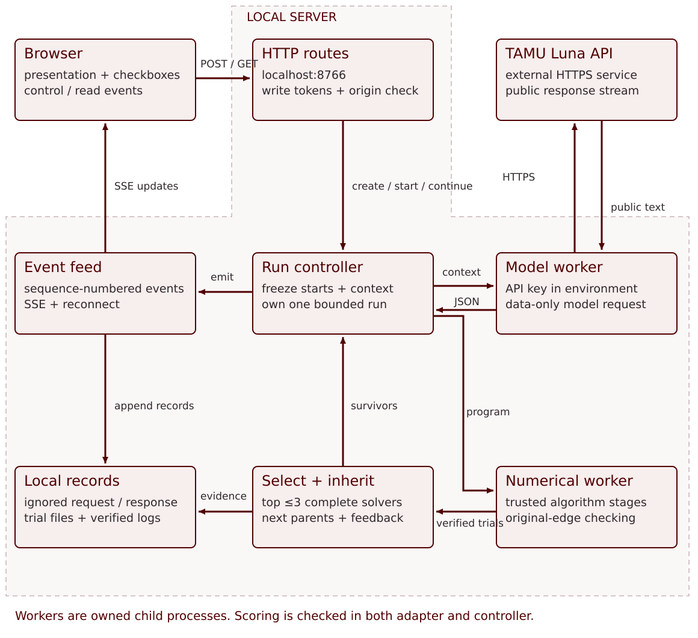
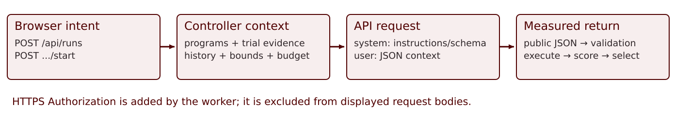

# What the system does

The browser is the presenter interface. The Python server owns the experiment.
Trusted numerical algorithms produce feasible sign vectors; an independent
harness measures their cuts. Luna proposes changes to solver programs. The
controller validates those changes, runs them and selects the next parents.

There are two nested searches. The **outer evolutionary search** changes a solver
program. The **inner numerical search** executes that program to find a partition.
The partition is a feasible witness used for evaluation. It is not a member of
the program population. The language model is the outer mutation operator; it
is neither the numerical executor nor the fitness authority.

The implementation is local, not a deployed multi-service platform. Start it with
`python demo/server.py --port 8766 --rounds 3`, then open
[the presentation hub](http://127.0.0.1:8766/). Only the model worker makes an
external API request. Visiting a page, reading a snapshot, reconnecting or replaying
recorded evidence cannot buy a new model generation.

# Architecture flow chart

{width=100%}

The scorer is checked in two places: inside the numerical adapter and again in
the controller after a worker returns. “Selection” and “event feed” are controller
responsibilities, not additional network services. The API worker contains the
credential boundary: its environment supplies the key; the browser never does.

The diagram is an editable SVG. The wider
[request data-flow diagram](http://127.0.0.1:8766/figures/request-data-flow.svg)
provides a second view suitable for discussing one round.

# Components and responsibilities

| Component | Main responsibility | Input and output |
| --- | --- | --- |
| `demo/static/presentation.*` | Frames, sequential block reveals, navigation and rehearsal clock | Shared presentation bundle; switches to the mounted demo without resetting it |
| `demo/static/app.js` | Solver checkboxes, mode, seed, round gate, table and witness views | Same-origin JSON control requests; snapshots and SSE events |
| `demo/server.py` | Fixed routes, origin/Host checks, write tokens and HTTP transport | Validated JSON; fixed static assets; event streams |
| `Manager` in `controller.py` | One active run, creation, reset, recording catalog and comparisons | Run configurations and owned `Run` objects |
| `Run` in `controller.py` | Initial evaluation, context, model requests, child trials, selection, stop and evidence | A bounded serial execution with append-only events |
| `proposals.py` | Schema, normalization, genome identity, mutation validation and context | Data-only strategy programs; no arbitrary executable model code |
| `model_worker.py` | One tool-free provider request | Public system/schema and user/context messages; public response and completion metadata |
| `backend.py` | Interpret one to three trusted algorithm stages | Graph, seed, starting signs and budget; verified witness and stage counters |
| `vendor/maxcut/` | Preserved numerical kernels and owned-process support | Immutable reference snapshot; 133 hashes checked |
| `demo/runs/<id>/` | Private local provenance | Requests, public responses, trial results, witnesses and terminal state; gitignored |

The server serves the presentation, numerical/model demonstration, full algorithm
guide, exact exchange, architecture document, detailed notes and PDF handout.
They share one origin, so the browser can read live state without receiving an
API credential or opening another execution controller.

# Control routes and what triggers a call

| Action / route | What happens | New model call? |
| --- | --- | --- |
| `GET /api/instance` | Read a pinned classroom graph and reference metadata | No |
| `GET /api/status` | Read provider/model availability, caps, presets, solver catalog and recordings | No |
| `POST /api/runs` | Validate and freeze a run configuration; return a run ID and write token | No |
| `POST /api/runs/<id>/start` | Start the one owned controller; evaluate selected seed programs | Not immediately in guided mode |
| `POST /api/runs/<id>/continue` | Release the current explicit round gate | Yes, when the live controller reaches `propose` |
| `GET /api/runs/<id>` | Read existing state | No |
| `GET /api/runs/<id>/events` | Subscribe to SSE or resume with an event cursor | No |
| `GET /api/runs/<id>/exchange/<round>` | Read exact public request/response evidence | No |
| `GET /api/comparisons` | Read current or verified stored experiment metrics | No |
| `POST .../stop` | Stop only that run's owned work and preserve evidence | No further call |
| `POST /api/reset` | Stop and clean up before creating a new configuration and token | No |

Write actions require same-origin checks and a run or bootstrap write token.
Start is idempotent: a second click does not create a second controller. Reading
SSE never starts a controller. There is no generic shell, file-write or file-read
endpoint. Static assets and private presenter aids have fixed allowlisted routes.

# Initial population and numerical execution

The checkboxes choose the seed population $P_0$. Each checked kernel contributes
its disclosed initial program. All four trusted kernels remain available to Luna
when it proposes children. This distinction is deliberate: changing initialization
is a different experiment from restricting the allowed hypothesis space.

The seed programs are:

| Full name | Initial configuration |
| --- | --- |
| Tabu Search | tenure 5, no stagnation restart, 800 iterations |
| Simulated Annealing | temperature 2 to 0.01, polish enabled, 6000 proposals |
| Breakout Local Search | disclosed defaults, 700 flips |
| Rank-two Burer–Monteiro method | 20 sweeps, 8 rounding directions, one solve |

At Start, the new population protocol constructs raw sign vectors from seeds
$s,s+1,s+2$ modulo $2^{32}$ and freezes them. Every seed program and every child
receives a copy of those same vectors. No candidate inherits an undisclosed final
assignment from another competitor. Within a multistage program, however,
`fresh=false` passes the best retained witness from one stage to the next.
`fresh=true` starts that stage's own seeded exploratory state while protecting the
old best if it remains better.

Numerical allowance is 8 seconds per current comparison or dense-case trial.
The historical torus retains its 1.5-second allowance. That clock covers all stages of one program. Remaining time is divided
among remaining stages; unused time carries forward. Process startup has a
separate bounded allowance. Kernel-specific work caps are additional limits,
not a claim that iterations, proposals, flips and rounding directions cost the
same amount.

The original torus recordings from the previous single-parent protocol remain
available as legacy evidence. Their frozen warm-start construction is not silently
reinterpreted as the new raw-start population protocol. New records carry the
initial solver selection, scenario and protocol explicitly.

# How one Luna request is created

1. The round gate exposes the selected parent programs to the presenter.
2. `Run.propose` takes up to three complete survivors and their measured evidence.
3. `proposals.context` combines those records with history, constraints and budget.
4. The controller saves a request description and increments the call count.
5. An owned `model_worker.py` subprocess creates the actual Chat Completions body.
6. The worker adds the credential as an HTTPS Authorization header and sends one
   request to the fixed TAMU endpoint.
7. Public response chunks are recorded and relayed as real events.

{width=100%}

The actual body uses model `protected.gpt-5.6-luna`, two messages and streaming.
The completion limit is **2400 tokens**, reasoning effort is low, and tool lists
are empty. The system message contains instructions and the required output schema. The user
message contains the serialized round context. TAMU's transport uses
`https://chat-api.tamu.ai/api/chat/completions`; it is not assumed to accept the
direct OpenAI Responses protocol.

The [exact exchange page](http://127.0.0.1:8766/exchange) shows the actual recorded
body and public return. Its display excludes the Authorization header. A replay
keeps a persistent label and withholds future received text until its recorded
response time. This prevents a prerecorded answer from appearing to be a new
model result.

# What the context contains

| Context field | Purpose |
| --- | --- |
| `round_id` | Bind the answer to the pending round |
| `parents` | IDs, normalized stage programs, median/minimum and three trial records |
| Trial `stage_results` | Algorithm outcomes, elapsed numerical time, work counters and completeness |
| `previous_genome_ids` | Avoid paying for identical normalized programs again |
| `actual_failures` | Explain rejected values, execution errors and censored trials |
| `initial_solver_selection` | Make the researcher's seed choice explicit |
| `mutation_scope` | State that unchecked trusted kernels remain allowed |
| `algorithm_names`, `allowed_defaults`, `config_bounds`, `work_caps` | Define available kernels and permitted edits |
| `graph_summary` | Public size and signedness information without an answer vector |
| `initialization`, `trial_seconds`, `trial_count`, `max_stages` | State the numerical comparison protocol |
| `remaining_seconds` | Limit proposals to remaining run resources |

The model does **not** receive solution vectors, stored replay, the preset
numerical comparison, benchmark name, reference target or API key in this context.
The fixed evaluator retains the graph and original edge weights. This makes the
model a strategy proposer rather than an answer-copying or self-grading service.
No model weights are trained or updated during the search; the external context
and selected programs carry learning across calls.

# How the response becomes measured evidence

The public answer must finish as JSON with the expected round, known parent IDs,
a short hypothesis, mutation category, up to two children and an optional plateau
reason. The controller validates each child's allowed stage fields, numerical
bounds, work caps and normalized identity. Invalid or duplicate children are
rejected without a silent repair or free retry.

Every admitted program runs serially on the frozen starts. The backend accepts
only original-order integer signs in {-1,+1}; it pins graph bytes by SHA-256 and
recomputes the cut using two independent scoring paths. The parent controller
checks the returned graph identity and recomputes witness quality again. A
reported model score has no authority.

A program ranks only when all three trials and every required stage complete.
Rank complete programs by higher median cut, higher minimum cut, fewer stages,
then stable genome identity. Keep at most three from parents plus children.
Separately retain the best valid witness, including one from an incomplete trial.
The next context contains the surviving programs and measured failures.

# Timing, cancellation and modes

The live profile permits three calls, two children per call, one to three stages
per program and serial trials. Each model call is bounded by 35 seconds. The run
deadline is 240 seconds, with owned cleanup by 250 seconds. Guided inspection
pauses consume the same deadline. A successful reference match does not force an
early stop in the teaching profile, so report calls-to-first-target separately
from later demonstration calls.

Stop and Reset identify owned processes by PID and start tick, not by a broad
process-name kill. Reset refuses to create overlapping work while cleanup is
pending. The real-provider Stop path was exercised in the prior revision.
Closing the local connection cannot establish that remote computation or billing
ends instantaneously.

- **LIVE LLM:** actual new provider proposals.
- **NUMERICAL ONLY:** disclosed fixed comparison program; zero model calls.
- **RECORDED LLM REPLAY:** verified prior live events; zero new calls, original
  model identity and timing distinct from playback speed.

No mode silently turns into another. Hidden reasoning is excluded from logs and
UI; public output, completion metadata and provider-reported usage are retained.

# The three demonstrations and what they establish

The old torus quickly saturated near reference 68. The presenter requested a case
with clearer algorithm differences. Five supplied public graphs were screened
using normalized classroom programs, identical raw seeds 3/4/5 and fixed work
limits. The selected `rand_pm_1000_s23.txt` has 1000 vertices and 5043 signed edges,
SHA-256 ebb1ee5df894bb2159cd29b2a65d237fa72c9d1fdc2080b2cc7cdb16f25a0503,
and supplied unproven reference 1098. Only graph input and scalar reference
metadata were imported. Public source records are:

- Graph provenance: `data/comparison_instance_provenance.json`.
- Normalized numerical screen, in `demo/evidence/`:
  `replacement_instance_screen_normalized.json`.

| Initial configured solver | Three measured cuts | Median |
| --- | --- | ---: |
| Simulated Annealing | 912, 948, 921 | 921 |
| Tabu Search | 980, 975, 964 | 975 |
| Breakout Local Search | 966, 992, 995 | 992 |
| Rank-two Burer–Monteiro | 1012, 1012, 1007 | 1012 |

These values use explicit normalized classroom defaults, including the Breakout
Local Search configuration. A preliminary direct-dispatch screen used that
kernel's implicit defaults and is not the current comparison evidence.

Preset 1 checks Tabu Search and Simulated Annealing. Preset 2 checks Tabu Search,
Breakout Local Search and Burer–Monteiro. Graph, starts, seeds, caps, mutation
space and ranking remain fixed. More seed programs cost more initial evaluations.
Burer–Monteiro is included because of measured performance here, not because every
evolutionary algorithm should start from it. The earlier BM-only torus control is
preserved as history, not retained as the current recommended starting suite.

```{=latex}
\Needspace{14\baselineskip}
```

| Replacement rehearsal | Limited suite | Informed suite |
| --- | ---: | ---: |
| Initial best eligible median | 975 | 1012 |
| Final best eligible median | 1008 | 1012 |
| Best valid witness | 1031 | 1060 |
| Completed model calls | 2 | 2 |
| Elapsed time | 24.003 s | 66.589 s |
| Reference 1098 | Not reached | Not reached |
| Terminal status | Finished | Failed validation |

The informed run's longer Burer–Monteiro → Breakout Local Search proposals left
incomplete trials. Their witnesses remained valid; their programs were excluded.
Its second response named an ineligible parent, so validation stopped the run.
This is a genuine provider failure case with recorded context and public response,
not a successful optimization run. The stronger initial suite did not establish a
faster or more effective full search in these observations. Do not force that story.

The six newly authorized attempts are exhausted: two network-sandbox DNS failures
before provider contact, then four real Luna calls across the two replacement
runs. No retries or further calls are hidden. Both valid finished and valid failed
sources can be replayed with their original terminal status; transport failures
without verified model results are ineligible for genuine replay.

The third case is a separate dense real-weight stress test: 100 vertices, 4950
edges, reference 402.5209. Its preserved three-call genuine run matched all three
trials after one call at 16.091s and finished at 56.602s. Sparse-1000 and dense-100
have similar edge counts but very different degree, density and weights. This is
a transfer test; greater density does not establish a universal hardness ordering.

One run per condition cannot establish a causal effect or model superiority.
The screened seeds are teaching evidence, not a held-out evaluation. Human
prior-design effort is also absent from the run clock. All references are unproven.

# Where to inspect the evidence

Use the live population table, actual mutation diff, exact exchange and measured
comparison table. Detailed local records are in ignored `demo/runs/<id>/`:
`request.json`, `config.json`, append-only `events.jsonl`, model context/payload/
public response, numerical trial requests/results, independently verified
witnesses and terminal `final.json`.

Public evidence summaries omit solution vectors. Current live sources:

- Limited, finished: `674ece0b370441dd9e68c7b53b35eb2d`.
- Informed, failed: `529482638cac4e17bca87f8587bc4cf7`.
- Dense, finished: `166aa16ae7c84e309fbed5af73b03b25`.

Earlier torus records remain unchanged and separately labeled. Read-only pages
and replay spend zero new calls.

The color base is Texas A&M's official Aggie Maroon, #500000, with white and
supporting neutral tones. See the
[university brand color specification](https://marcomm.tamu.edu/creative-platform/visual-style/brand-colors/).
