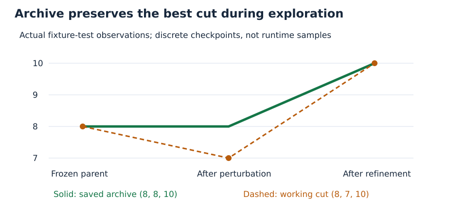

# From a partition to an honest stopping decision

A signed edge contributes its weight exactly when its endpoints are separated. A positive edge prefers separation; a negative edge prefers equal labels. Trying a worse partition may help escape a local trap. Saving that worse partition over a better archive is unnecessary.

For original-order signs $s_i\in\{-1,+1\}$, the unchanged objective is

$$
F(s)=\sum_{\{i,j\}\in E}w_{ij}\frac{1-s_i s_j}{2}.
$$

Let $W=\sum_E w_{ij}$ and let $r$ be the unchanged reference. The official normalized score is

$$
S(s)=\frac{F(s)-W/2}{r-W/2}.
$$

The controller rejects a nonfinite or nonpositive denominator. With positive denominator, the default target $S\geq1$ is equivalent to $F\geq r$. For a deliberately higher configured target $T$, the corresponding threshold is $F\geq W/2+T(r-W/2)$. Scores are neither clipped nor rounded for decisions.

`metrics` reproduces the official loader and summation. Separately it sums finite-decimal represented edge weights with `Fraction` and compares the exact threshold. A disagreement between the official floating comparison and that diagnostic requires `numerical_review_required`; it does not apply an arbitrary epsilon. Exact decimal diagnosis cannot independently certify a native floating-point SDP bound.

The archive update is

$$
B_{t+1}=\max\left(B_t,\max_{j,k}F(s_{j,k})\right).
$$

Candidate fitness comes from that artifact's own verified search witnesses. An operational incumbent retention/fallback remains separately labeled; it does not become native-search evidence. An unselected candidate can still improve $B$. An independently checked target witness establishes target attainment, while its proof field remains `unproven` unless the existing protected backend contract reports stronger evidence. No new serialized SDP certificate checker is implemented.

For every valid trial, the unchanged `evaluate.py` scores a fresh folder containing this trial's actual target labels and the frozen campaign-start labels of all other graphs. Receipts say **assembled ladder score, target-only reevaluation**. They do not establish that the evolved algorithm solved the other graphs. Other missing/bad files remain official failures. If the initial target itself is missing, a declared feasible all-plus initialization has its own assembled receipt, separate from the original incomplete starting folder.

With $R$ nonempty rungs and $N_q$ graphs in rung $q$, the official aggregation gives each rung equal weight, not each graph:

$$
S_{\rm overall}=\frac1R\sum_q\frac1{N_q}\sum_{g\in q}S_g,\qquad
\Delta S_{\rm overall}=\frac{\Delta S_g}{R N_{r(g)}}.
$$

The unequal-rung fixture has two graphs in rung 0 and one in rung 1. Its trap score rises from $1/3$ to $1$, so overall rises by $(2/3)/(2\cdot2)=1/6$, from $5/6$ to $1$. These values come from unchanged official scoring receipts and are checked in `test_trap_escape_censor_and_assembled_rungs`.

## The actual cut-eight trap

The four-node graph has $w_{AB}=w_{CD}=3$ and four cross weights $w_{AC}=w_{AD}=w_{BC}=w_{BD}=2$. Thus $W=14$, exact toy reference $r=10$, and the partition $AB/CD$ has cut 8 and score $1/3$. Each one-flip gain is $-1$, so positive-gain greedy search is stuck.

The saved fixture selector flips A (symmetry-equivalent to flipping B in the brief). That creates $B/ACD$, cut 7 and score 0. One bounded tabu refinement reaches a partition of cut 10 and score 1. The archive keeps 8 during the exploratory cut-7 state, then retains 10. The figure reads the actual saved fixture observation; it does not invent a live Codex improvement.

Enumeration can independently prove the toy optimum. Matching a public reference does not imply that the reference or candidate has a proof of global optimality. The professor's approximately 0.9992 overall quality threshold and this user's score-at-least-1 per-selected-graph goal are different quantities. Current retained overall remains approximately 0.9713800082.
