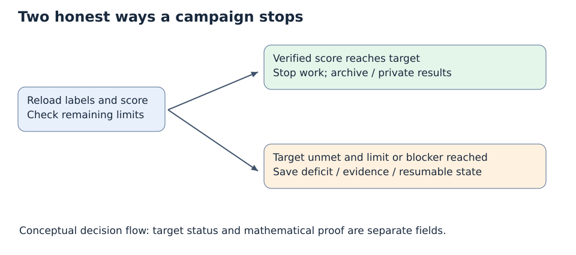

# Explicit policies and resource units

Think of selection as a controlled comparison and the archive as a notebook of every useful partition. A comparison cannot inherit an archive score that its candidate never produced. An exhausted budget cannot be renamed success.

| Setting | Default | Meaning |
|---|---:|---|
| Target | 1.0 | Unchanged official instance score, with exact threshold diagnostic |
| Ordinary rounds | 20 | Screening is separate round 0 |
| Active campaign time | 7200 s | Cumulative initialization, numerical/model/check/verification/commit time; paused downtime excluded |
| Codex calls | 25 | Includes invalid output and the one allowed correction |
| Call timeout | 180 s | Bounded real process and descendants |
| Solver-call slots | 500 | Includes actual stages and eight-example admission checks |
| Screening | 5 s per candidate | All compatible discovered entries once, unless stopped early |
| Ordinary candidate | 30 s | Aggregate numerical + independent verification allowance |
| Repeats | 2 | Comparable real samples; identical replay is cached and deduplicated |
| Children / survivors | up to 3 / up to 3 | Novel inherited artifacts; no artificial mandatory code-edit quota |
| Admission check | 5 s | Aggregate eight tiny signed/ownership examples, not five seconds per example |
| Finalization reserve | 5 s | Held before launching work; operational cleanup/write latency can still exceed estimates |
| BM work cap | 8 | Existing complete-pass units, in addition to wall limit |
| Parallel trials | 1 | Serial outer trials; an existing native solver may use its actual MPI ranks |
| Automatic commits / public publication | false / false | User commits; explicit consolidation publishes results |
| Concurrent campaigns | User-selected IDs | Independent campaign locks; batch defaults to 2 controllers |

The user increased the defaults from 250 slots / 3600 active seconds to
500 slots / 7200 active seconds after the first two public campaigns. Both the
JSON config and Python defaults use these values for new campaigns. Saved
campaign configs, spent counters and frozen source manifests retain their original
values; this default change does not revise or restart them. The 25-call model
cap is unchanged. Every cap still applies independently, so a run may stop before
two hours. The Class001 campaign script now requests 2 hours 15 minutes in Slurm.

The later [concurrency update](CONCURRENT_CAMPAIGNS.md) removes branch switching,
automatic commits and shared publication from the campaign loop. Each campaign
owns a private round log and results folder. A closed manifest/receipt permits the
next round without Git. Caps apply separately to each concurrent campaign, not
as a shared account-wide token or CPU budget. Historical commit-based receipts
remain intact and are not silently migrated.

These are bounded engineering defaults, not optimized public-graph parameters. No new optimization campaign established that they are best. `plan` reports requested screening time and whether nominal work can exceed the cap. Large graph validation and startup may consume a short allowance; a timeout or measured verification overrun is explicit and cannot win a fair comparison. Cumulative accounting includes initialization. Crash recovery conservatively charges a lost reservation's full allowance; it never grants that work back.

The default selection order is highest exact own best cut, highest exact median across valid comparable own witnesses, lowest measured completion-time upper bound to best (including earlier failed execution cost), then stable artifact ID. Failed/nonsearch trials remain in raw evidence rather than silently becoming successful samples. The JSON ranking records actual sample count; early success can leave incomplete/censored comparisons. A predeclared diversity slot may replace the last survivor with a different backend, preserving the best-ranked artifact.

Local stochastic seeds are a stable hash of graph identity, campaign seed, round, repeat and comparison role; paired parents/children share the comparison seed. BiqBin and MADAM retain actual seed 2020. MQLib uses its supported reduced seed range. Deterministic exhaustive/planar/toroidal-bound executions reuse their deterministic seed; cache conditions also include complete artifact, graph, frozen state when used, work caps, effective allowance and adaptive stagnation. Reusing the exact same execution is not an independent sample.

After three ordinary rounds without a strict archive gain, a continuing plan must explain diversification. The prompt asks Codex to consider stronger supported perturbations, adaptive strength, restart strategy, or a justified change of method. The controller still requires a genuinely novel inherited artifact and rejects seed/filename-only novelty. It does not force an unjustified source change or automatically increase any budget. Codex may explain a plateau and stop unsuccessful.

State policies describe actual representation: binary flips affect exactly the selected original nodes; BM angles use 0/pi plus declared perturbations measured in radians. Every selector/search receives owned copies; graph edges and adjacency and the caller's frozen labels are checked after execution. Supported adaptive strength is replayable from saved stagnation and RNG state inputs; the LLM does not choose every spin flip.

A two-stage child splits one allowance using positive fractions summing to at most 1. Stages consume separate solver slots, and share the original total deadline. They never receive two full candidate budgets. Neither topology nor memory guards are lifted by default. An explicit guard opt-in still needs a per-proposal resource estimate.

The framework stops on target, numerical review, credible unreachable target evidence, elapsed/call/round/solver limits, SIGINT, durable stop, source/input inconsistency, unavailable Codex, or Git failure. `certification_after_target=true` is rejected because no separate certification campaign is implemented. A completed public per-graph campaign may still fail to reach its target; its remaining deficit and evidence remain inspectable and resumable.
