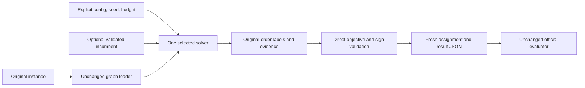

# The basic architecture and data flow

The original `bm_solver.Graph` stays the shared graph. It has an original-order node count, a once-counted edge list `(i,j,w)`, and symmetric sparse neighbor lists. Python indices are zero based; instance and saved-assignment formats remain the professor's original formats. Graph weights stay fixed while signs change. No new implementation constructs a dense graph matrix for ordinary sparse searches.



`solver_portfolio.solve(graph, config, seed, budget, initial_assignment=None, solver="bm")` dispatches through ordinary explicit branches. It does not choose methods, evolve populations, or tune settings. `portfolio_common.py` owns consistent results and exact decimal scaling. Search, dynamics, conditional repair, topology, MILP, and native adapters stay in small separate modules. The old BM implementation and CLIs remain available.

- `graph`: fixed `Graph`, signs in its original node order; treat its fields as read-only.
- `config`: dictionary of method parameters. Unknown keys raise an error. Empty `{}` selects documented defaults; the result records resolved values.
- `seed`: nonnegative Python integer, stored unchanged. Local methods use a solve-local NumPy generator. SCIP uses a documented modulo seed shift; TESB temporarily reseeds its legacy generator modulo $2^{32}$ and restores caller state. MQLib accepts 0–65535. BiqBin and MADAM **require 2020**, because their pinned source hardcodes it. Other native adapters require signed-32-bit seeds.
- `budget`: `{"seconds": 60, "max_work": 10000}`. Seconds are finite and nonnegative; max_work is an optional nonnegative integer. Work units differ by method; inspect `--features`. For native MQLib, BiqBin, MADAM and BiqCrunch, omit max_work: these interfaces expose a runtime allowance, and unsupported counters are rejected.
- `initial_assignment`: optional validated length-$n$ signs. Its actual use is in the capability table. Unsupported native warm starts are rejected. Retention alone is distinguished from native injection or initial state initialization.

The API checks time cooperatively. Old BM calls, one matching computation, SCIP model construction, and TESB phase calls can exceed the API deadline before returning. **Use `run_solver.py` for a hard worker deadline**, including optional imports and worker setup. A stopped worker may not have serialized its best internal state: the runner then returns only the supplied incumbent or known all-plus labels. It records that fallback explicitly. Parent input checking, output saving and official verification add separately measured overhead. A timeout is never a proof of optimality.

Each invocation reserves a fresh output directory. It contains `request.json`, `result.json`, `worker.log`, actual native logs/converted inputs where applicable, and independently checked `solutions/<input basename>`. An existing output directory is rejected. Inputs are hashed before and after solving; the result records the raw file hash, semantic graph hash, actual code hashes, dirty Git identity, parameters, seed, runtime, counters and provenance.

The result separates `execution_status` (`completed`, `time_limit`, `unavailable`, `failed`), `solution_valid`, and `optimality_status`. A valid assignment can accompany an unsuccessful native execution or a timeout. `cut` is recomputed from original labels, never copied from a backend's objective. `upper_bound` is null unless actually computed. `solver_reported_optimal` records enumeration completeness, native status/tolerances, or a verified matching reduction. No adapter here emits `checked_certificate`: no independent certificate-checker is implemented. Conditional neighborhood optimality is not global optimality.

For the official public graphs, the runner also invokes the unchanged official loading/scoring functions. Tiny scratch fixtures have no reference score, so `official_verification.score` is null while their cut is still corroborated. Matching a professor reference or normalized score 1 is a comparison result, not automatically an optimality certificate.

## Minimal commands

```bash
uv sync
uv run python run_solver.py --list
uv run python run_solver.py --solver tabu --features
uv run python run_solver.py \
  --solver bm --instance instances/public/rand_pm_1000_s23.txt \
  --config configs/portfolio/bm.json --seed 1 --time-limit 60 \
  --output runs/bm_example_01
```

Choose a new suffix on each invocation. Read `result.json`, then inspect the unchanged professor visualizer if desired:

```bash
uv run --extra viz viz.py both \
  --instance instances/public/rand_pm_1000_s23.txt \
  --assignment runs/bm_example_01/solutions/rand_pm_1000_s23.txt
```

These are user-run examples; no full public-ladder campaign was launched in this implementation phase.
