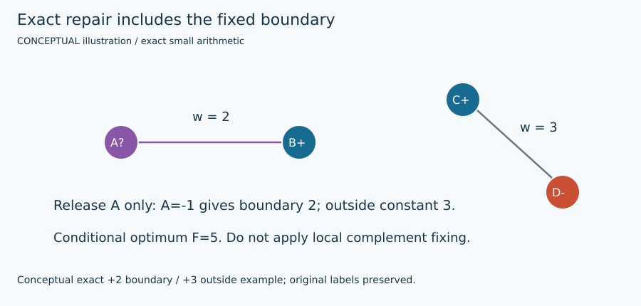

# Objective, signs, transformations, and evidence

Every method is evaluated by

$$
F(s)=\sum_{\{i,j\}\in E}w_{ij}\frac{1-s_i s_j}{2},\qquad s_i\in\{-1,+1\}.
$$

An edge occurs once. Different signs contribute its fixed weight, including a negative penalty. Equal signs contribute zero. Complementing all signs preserves every product: $F(s)=F(-s)$. Thus global exhaustive search can fix $s_0=+1$ and examine $2^{n-1}$ assignments. Fixing a released neighborhood spin is generally invalid when outside signs are fixed.

For minimization under $E(s)=-\sum_{\{i,j\}}J_{ij}s_i s_j$ with zero field, take $J=-W$. With $C=\sum_Ew_{ij}/2$, the conversion is $F=C-E/2$. A symmetric matrix expression counts both orientations, so $E=-s^TJs/2$ and $F=\sum_Ew/2+s^TJs/4$. These factors matter when comparing an energy to a cut. The sparse dynamics accumulate both endpoint fields but score each edge only once.

A one-flip gain is

$$
g_i=F(s^{(i)})-F(s)=s_i\sum_j w_{ij}s_j.
$$

For old sign $a=s_i$, the update is $g'_i=-g_i$ and $g'_j=g_j-2w_{ij}a s_j$ for neighbors. An unrelated coordinate's field is unchanged. A simultaneous pair flip has gain $g_i+g_j-2w_{ij}s_i s_j$, because the internal edge's two individual contributions must be removed. Tests compare fields to direct differences after positive, negative, zero and decimal-weight moves.

The BM relaxation is

$$
R(\theta)=\frac12\sum_E w_{ij}[1-\cos(\theta_i-\theta_j)].
$$

A sequential coordinate update builds $h_i=\sum_jw_{ij}v_j$ and sets $v_i=-h_i/\lVert h_i\rVert$ except under the preserved near-zero-field policy. Later coordinates see the newly updated vector immediately. Hyperplane rounding uses $s_i=\operatorname{sign}(v_i\cdot r)$; the separating line is perpendicular to $r$. Actual cut selection and binary improvement follow. An encountered nonconvex rank-two objective is **not a certified upper bound**.

## Exact integer conversion and SDP inputs

`integer_weights` converts `Fraction(str(float_weight))`, takes the LCM of denominators, and uses exact Python integers. The supported input is the graph loader's finite floating value; extra textual precision already lost by that original loader is not recovered. Default scale guard is $10^9$ and total magnitude guard is $2^{50}$; SDP adapters tighten magnitude to $2^{45}$ and individual scaled edges to $2^{30}$. Unsupported precision/range fails rather than silently rounding. For $0.1,-0.25$, scale 20 gives integers $2,-5$. Native objectives and bounds are divided by the same scale.

BiqBin and MADAM consume one-based GSet edges. BiqCrunch consumes its upstream converter's sparse BC Laplacian with dimension $n+1$: $L_{ii}=\sum_jw_{ij}$ and $L_{ij}=-w_{ij}$. The Max-Cut-specific binary handles the quadratic objective's factor $1/4$; the adapter does **not** multiply or divide its input entries again. Its dummy homogenizing node is excluded from output labels. Recovered native membership lists map back to all original node IDs; complementing a side does not affect $F$.

Native root bounds printed to a limited number of decimal places are padded outward before integer flooring and rescaling. This protects formatting precision, not arbitrary numerical errors in floating SDP optimization. Native optimality remains a solver report within upstream numerical assumptions. A failed/truncated parser cannot claim a native witness. SMS omits identically zero edge records because its parser rejects them, retains the declared full node count, removes native dummy node zero, and compacts ascending original IDs; it changes no objective contribution. Its partition JSON must cover every original node exactly once.

## Exact XOR MILP

Let $x_i=(1-s_i)/2$, $x_i\in\{0,1\}$, with continuous $0\le y_{ij}\le1$. Add all four inequalities:

$$
\begin{aligned}
y_{ij}&\ge x_i-x_j,&y_{ij}&\ge x_j-x_i,\\
y_{ij}&\le x_i+x_j,&y_{ij}&\le2-x_i-x_j.
\end{aligned}
$$

For $(x_i,x_j)=(0,0)$ the first upper bound forces $y=0$; $(1,1)$ uses the second upper bound. Either unequal pair has a lower bound 1 and upper bound 1. Therefore $y=|x_i-x_j|$ for **both signs of weight**. Maximize $\sum_E w_{ij}y_{ij}$ with no offset or factor change. Global symmetry fixes $x_0=0$. Conditional repair instead fixes outside variables and adds no arbitrary released-spin symmetry constraint.

For release set $B$, repair decomposes

$$
F=C_{\mathrm{out}}+\sum_{\{i,j\}\subset B}w_{ij}\frac{1-s_i s_j}{2}
+\sum_{i\in B,j\notin B}w_{ij}\frac{1-s_i\bar s_j}{2}.
$$

The last sum supplies effective linear terms. A +2 boundary from released A to fixed B+ is optimized at A−, contributing 2. If a fixed outside edge contributes 3, full conditional optimum is 5. Dropping that boundary or its constant would misreport the problem.

## Bounds and topology

Every feasible cut is a lower bound: $F(s)\le F^*\le U$. Equality with a valid computed upper bound supports optimality under that bound's assumptions. Exact planar signed matching uses preferred cut indicators $t_e=1$ for positive weights, with violated-edge cost $|w_e|$. A face-parity minimum T-join costs $D$, so $F^*=\sum_E\max(w_e,0)-D$ on a verified planar embedding. Bridges belong twice to an outer face and cause no false parity defect. The implementation reconstructs signs and checks its direct objective against that expression in exact scaled integers.

A torus is different: elementary face constraints omit two noncontractible global-cycle consistency conditions. Matching over the local relaxation produces $U$ even if its edge choices cannot be integrated into globally consistent signs. `toroidal_bound` and `toroidal_search` return a separately reconstructed feasible assignment; the latter repairs global cycles using upstream primitives. A measured 3×3 example has feasible 8 and bound 9, leaving gap 1. Neither local parity nor a good-looking drawing closes that gap. Both periodic directions must be preserved.

## Hand-worked reference instances

| Input | Best partition / reasoning | Exact optimum |
|---|---|---:|
| +2 edge AB | A+, B− cuts it | 2 |
| −2 edge AB | A+, B+ avoids penalty | 0 |
| all-positive unit triangle | two edges can cross, three cannot | 2 |
| unit four-cycle | alternate signs around the even cycle | 4 |
| triangle AB=5, BC=3, AC=1 | B differs from A=C: 5+3 | 8 |
| triangle AB=4, BC=3, AC=−2 | B differs from A=C: 4+3; avoid −2 | 7 |
| triangle AB=4, BC=−3, AC=−2 | A differs from B=C: 4−2 | 2 |
| trap AB=CD=3, cross edges=2 | AC versus BD: 3+3+2+2 | 10 |

The trap's AB versus CD cuts four edges of weight 2 for 8. Every single-flip gain is $3-2-2=-1$, so it is locally optimal. Flipping A gives 7; then flipping D yields AC versus BD with 10. A strict one-flip improver cannot take the first step; tabu, BLS and annealing deliberately can. The supplied raw tabu trace illustrates this with measured current and retained-best curves.
