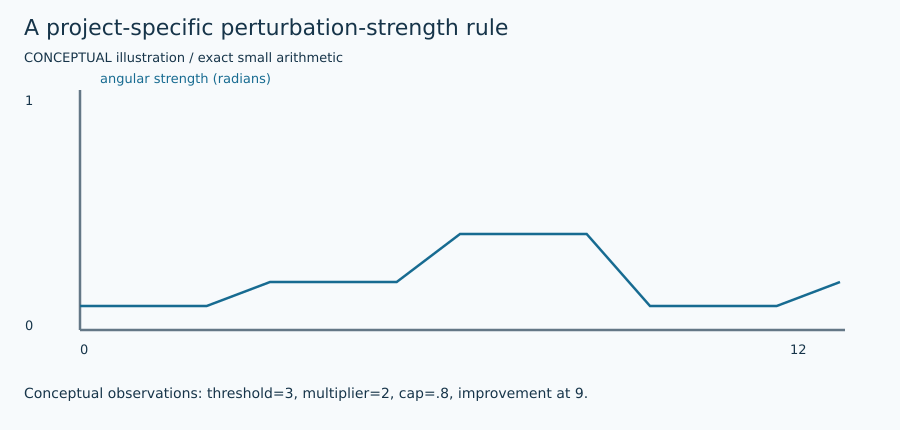

# Explicit perturbations for future experiments

These are prepared functions, not an evolutionary controller or an automatically selected solver. They return owned copies and original node IDs. They do not mutate the caller's assignment, angles, graph or RNG objects beyond the explicitly supplied generator's draws.

| Representation | Function / settings | Meaning |
|---|---|---|
| Binary | `perturb_binary(graph, signs, k, rng, "uniform")` | Choose k distinct nodes uniformly and flip each once. |
| Binary | rule `connected` | Start from a seeded root and breadth-first release a connected region; if its component is exhausted, fill remaining requested nodes uniformly. Across disconnected components the final set is not promised connected. |
| Binary | rule `violated` | Prefer nodes by incident unsatisfied absolute edge weight: positive uncut edges and negative cut edges are violations. If fewer than k nodes have positive weight, fill remaining nodes uniformly. |
| Binary | rule `mixed` | Choose one of the documented uniform/connected/violated rules with the solve's RNG. It does not choose a solver by performance. |
| BM angles | `perturb_selected_angles(..., count=n, scale=delta)` | Uniform additive noise in [−delta,+delta] radians at every angle, wrapped consistently with the original angular helper. |
| BM angles | count=k, uniform / connected / violated / mixed | The same angular noise only at the selected original node IDs. Unselected coordinates are exactly unchanged. |
| Strength | Fixed delta | Explicit experiment control; no adaptation is hidden. |
| Strength | `adaptive_strength(...)` | A separate project extension: reset on improvement; multiply after a declared stagnation threshold; cap at maximum. |
| Neighborhood | `repair_exact` / LNS | Release B, fix outside, optimize full internal + boundary + outside-constant problem. Partial repair is distinguished from complete conditional optimization. |

For strength delta in radians, the pure controller returns `(new_delta,new_counter)`:

$$
(\delta',c')=\begin{cases}
(\delta_{min},0),&\text{after a strict improvement},\\
(\min(\gamma\delta,\delta_{max}),0),&c+1\ge\tau,\\
(\delta,c+1),&\text{otherwise}.
\end{cases}
$$

Defaults are minimum=.05, maximum=1, multiplier=1.5, threshold=5. The caller exposes the exact improvement event, threshold, multiplier and limits; this is not attributed to BM or BLS. It is deliberately not wired into their settled defaults. Angular perturbation assumes one finite angle per original node, not a Cartesian x/y momentum state.

A useful sanity check starts with all-zero angles, perturbs exactly two selected indices, and verifies that every other entry remains zero. Binary tests similarly verify that the changed-coordinate set equals the selected set. Copy/selection assertions cover all four rules, disconnected components and zero violation weight.

No arbitrary perturbation is added to continuous bifurcation state variables here. Their different positions, momenta, pumps and interacting replicas need a separately justified equation-level variant. Exact native backends only use perturbed signs as real warm-start suggestions where the inspected interface supports injection; unsupported suggestions are rejected.
