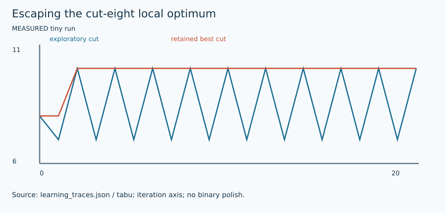

# Simulated annealing comparison baseline

Cluster-local revision: [CLASS001_SEARCH_V4.md](../evolution/CLASS001_SEARCH_V4.md)
documents a prepared separate source version with time-based uncapped cooling,
explicit fixed-work telemetry and a calibrated comparison driver. The live root
kernel still has its historical 10000-proposal default; no pinned campaign has
been hot-edited. Numerical verification/calibration for the new version is pending.

## 1. Problem and supported input

The target is original signed weighted Max-Cut: $F(s)=\sum_E w_{ij}(1-s_i s_j)/2$. Each edge is counted once; positive weights favor opposite signs and negative weights favor equal signs. Original node order is preserved. See [shared contract](ARCHITECTURE.md) and [objective/transformation details](MATHEMATICS.md). This method's actual availability, topology/size restrictions, warm-start use and work unit are exposed by `uv run python run_solver.py --solver annealing --features`.

## 2. Intuition

Accept some negative-gain proposals while temperature is high; reduce that probability as cooling proceeds. This is a transparent comparison baseline.

## 3. Formulation and conventions

$P_{accept}=\min(1,\exp(\Delta F/T))$ for maximized cut and $T>0$. The implementation compares $\log U<\Delta F/T$ for negative gains.

## 4. Algorithm steps

Copy current and best. Uniformly sample a node for every proposal. Interpolate log temperature between configured endpoints over the proposal budget; accept all nonnegative gains and probabilistically accept negative ones. Update maintained gains only after acceptance. Optionally polish retained best by bounded positive-gain flips.

## 5. Fully worked small example

At the trap, a −1 proposal at $T=2$ is accepted with probability $e^{-1/2}\approx0.60653$. At $T=.01$ it is about $3.72\times10^{-44}$. A high-temperature accepted move may enable reaching 10; neither probability guarantees that outcome.

[All required hand examples](MATHEMATICS.md#hand-worked-reference-instances) and [validation report](VERIFICATION.md) provide independent reference optima and original-format fixtures.

## 6. Illustration



Figures are labeled conceptual or measured. Numerical traces come from preserved tiny-run JSON/logs; arrows in conceptual diagrams are explanatory geometry, not measured backend events. [Regeneration and provenance](FIGURES.md).

## 7. Parameters and effects

initial_temperature=2 and final_temperature=.01 are cut/weight units; multiply temperatures with graph weight scaling. max_work counts individual proposals, so n proposals are one sweep. polish=True adds at most min(n,max_work) flips before the same deadline. No reheating.

Copyable config: [`configs/portfolio/annealing.json`](../../configs/portfolio/annealing.json). Do not supply unsupported options; they are rejected rather than silently ignored.

## 8. Complexity and memory

Proposals are $O(1)$ to choose and $O(deg(i))$ when accepted; local polish scans $O(n)$ per flip. Sparse $O(n+m)$ memory.

## 9. Exactness and certification limits

Heuristic with null upper bound. raw_cut is best SA before polishing; polished_cut is the returned hybrid cut. The hybrid flag identifies the extra local search. Execution status, feasible assignment and optimality evidence remain separate. No serialized independently checked certificate is claimed by this portfolio.

## 10. Source-to-code mapping

portfolio_search.solve_annealing. Myklebust 2015 is the primary Max-Cut SA context, not a claim to implement all of its optimized mechanisms.

Primary source records: [`sa`](../../papers/README.md#sa). [External pins/builds](EXTERNAL_BUILDS.md) and [reading notes](SOURCE_REVIEW.md) distinguish obtained full text, unavailable PDFs, and inspected source code.

## 11. Run and interpret outputs

```bash
uv run python run_solver.py --solver annealing \
  --instance evidence/portfolio/shared_validation_final/inputs/trap.txt \
  --config configs/portfolio/annealing.json --seed 1 \
  --time-limit 10 --output runs/annealing_example_01
```

Choose a new suffix if the output already exists. Optional methods require their extras/source builds from [setup](EXTERNAL_BUILDS.md). Read `result.json` and actual `worker.log`/native logs; `solutions/<input basename>` is written only for validated labels. The tiny example has no professor reference score: official cut verification still runs, while reference score is null. `upper_bound=null` means no bound was computed, not zero gap. QuBowl deliberately returns unavailable with no assignment.

## 12. Implementation deviations

Uniform random proposals, geometric cooling and bounded final polish are the project baseline. Myklebust’s full optimized solver is not reproduced.
