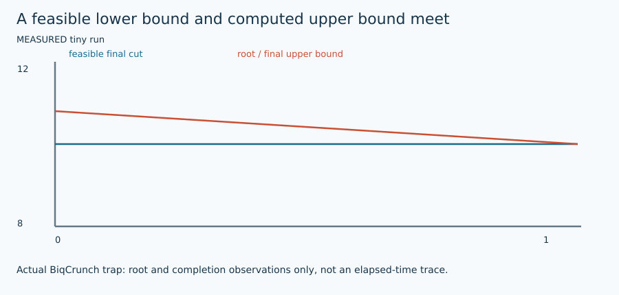

# BiqCrunch semidefinite branch-and-bound

## 1. Problem and supported input

The target is original signed weighted Max-Cut: $F(s)=\sum_E w_{ij}(1-s_i s_j)/2$. Each edge is counted once; positive weights favor opposite signs and negative weights favor equal signs. Original node order is preserved. See [shared contract](ARCHITECTURE.md) and [objective/transformation details](MATHEMATICS.md). This method's actual availability, topology/size restrictions, warm-start use and work unit are exposed by `uv run python run_solver.py --solver biqcrunch --features`.

## 2. Intuition

Runs the official BiqCrunch 2.0 Max-Cut executable, not the project MILP. Its numerical SDP bounds prune a binary branch-and-bound search.

## 3. Formulation and conventions

Exact integer weights become the sparse graph Laplacian BC input, dimension n+1, matching upstream tools/mc2bc.py: diagonal sum(w), off-diagonal -w, objective matrix identifier 0. The Max-Cut-specific binary handles its quadratic 1/4 factor. Parse one-based side membership, omit only the optional dummy node.

## 4. Algorithm steps

Validate supported input, seed, budgets and warm-start capability. Reserve a unique native artifact tree; write the inspected conversion and native parameters. Run the actual executable with owned-process timeout cleanup. Recover a real native witness; independently validate signs, direct original F and native primal agreement. Preserve raw logs, source pin, executable SHA, status and any computed bound.

## 5. Fully worked small example

For +2 AB, L=[[2,−2],[−2,2]], and s=(+1,−1) gives s^T L s /4=2. Do not multiply BC entries by another 1/4. The measured trap root bound exceeds 10 and closes to primal=dual=10.

[All required hand examples](MATHEMATICS.md#hand-worked-reference-instances) and [validation report](VERIFICATION.md) provide independent reference optima and original-format fixtures.

## 6. Illustration



Figures are labeled conceptual or measured. Numerical traces come from preserved tiny-run JSON/logs; arrows in conceptual diagrams are explanatory geometry, not measured backend events. [Regeneration and provenance](FIGURES.md).

## 7. Parameters and effects

max_nodes=5000 conservative guard; actual seed parameter, native time_limit rounded up to an integer while outer CLI enforces the hard deadline. No warm-start interface exposed; max_work rejected.

Copyable config: [`configs/portfolio/biqcrunch.json`](../../configs/portfolio/biqcrunch.json). Do not supply unsupported options; they are rejected rather than silently ignored.

## 8. Complexity and memory

Conversion is sparse O(n+m). Native SDP methods can use dense O(n²) matrices and expensive bound work; sparse exact/MQLib internal memory depends on its actual native algorithm. Conservative adapter guards do not predict practical runtime or avoid every native allocation.

## 9. Exactness and certification limits

Native Maximum with successful completion and direct witness check supports solver_reported_optimal. Root SDP value is an upper bound, never substituted for a feasible cut. Conservative textual rounding does not certify floating SDP arithmetic. Execution status, feasible assignment and optimality evidence remain separate. No serialized independently checked certificate is claimed by this portfolio.

## 10. Source-to-code mapping

external/BiqCrunch/.../problems/max-cut/biqcrunch; original converter/manual and source archive hash.

Primary source records: [`biqcrunch_manual`](../../papers/README.md#biqcrunch-manual). [External pins/builds](EXTERNAL_BUILDS.md) and [reading notes](SOURCE_REVIEW.md) distinguish obtained full text, unavailable PDFs, and inspected source code.

## 11. Run and interpret outputs

```bash
uv run python run_solver.py --solver biqcrunch \
  --instance evidence/portfolio/shared_validation_final/inputs/trap.txt \
  --config configs/portfolio/biqcrunch.json --seed 1 \
  --time-limit 10 --output runs/biqcrunch_example_01
```

Choose a new suffix if the output already exists. Optional methods require their extras/source builds from [setup](EXTERNAL_BUILDS.md). Read `result.json` and actual `worker.log`/native logs; `solutions/<input basename>` is written only for validated labels. The tiny example has no professor reference score: official cut verification still runs, while reference score is null. `upper_bound=null` means no bound was computed, not zero gap. QuBowl deliberately returns unavailable with no assignment.

## 12. Implementation deviations

Official 2.0 archive is identified by exact SHA rather than an invented Git revision. The 2017 TOMS PDF was unavailable; the full official manual and distinct 2012 author preprint of the 2014 bounding paper were downloaded/read.
