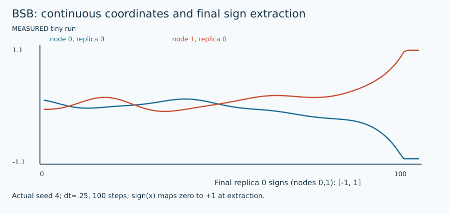

# Ballistic simulated bifurcation

## 1. Problem and supported input

The target is original signed weighted Max-Cut: $F(s)=\sum_E w_{ij}(1-s_i s_j)/2$. Each edge is counted once; positive weights favor opposite signs and negative weights favor equal signs. Original node order is preserved. See [shared contract](ARCHITECTURE.md) and [objective/transformation details](MATHEMATICS.md). This method's actual availability, topology/size restrictions, warm-start use and work unit are exposed by `uv run python run_solver.py --solver bsb --features`.

## 2. Intuition

Evolve continuous positions and momenta, with continuous neighbors in the force, then extract binary signs at the final time.

## 3. Formulation and conventions

With $J=-W$, $y^{new}=y+\Delta t[-(1-a(t))x+c_0Jx]$; $x^{new}=x+\Delta t\,y^{new}$. Set $a(t)=t/T$. If $|x_i|>1$, set $x_i=\operatorname{sign}(x_i),y_i=0$.

## 4. Algorithm steps

Initialize independent n×R position and momentum arrays uniformly in (−.1,.1). At each step update all momenta from old positions, then positions from new momenta, then apply inelastic walls. Track sample positions. Extract sign, with final zero mapped to +1, evaluate each final replica and retain best/incumbent.

## 5. Fully worked small example

For +2 AB, x=(.1,−.2), y=0, c0=.5, dt=.1, initial ramp zero, Jx=(.4,−.2). Force=(.1,.1), new y=(.01,.01), new x=(.101,−.199). Opposite extracted signs cut weight 2.

[All required hand examples](MATHEMATICS.md#hand-worked-reference-instances) and [validation report](VERIFICATION.md) provide independent reference optima and original-format fixtures.

## 6. Illustration



Figures are labeled conceptual or measured. Numerical traces come from preserved tiny-run JSON/logs; arrows in conceptual diagrams are explanatory geometry, not measured backend events. [Regeneration and provenance](FIGURES.md).

## 7. Parameters and effects

replicas=8 independent columns, dt=.25, a0=1 only, c0=None selects .5*sqrt(n−1)/sqrt(2*sum(w²)), or supply nonnegative c0. Empty-field scale is 0. max_work counts integration steps; polish=False by default.

Copyable config: [`configs/portfolio/bsb.json`](../../configs/portfolio/bsb.json). Do not supply unsupported options; they are rejected rather than silently ignored.

## 8. Complexity and memory

$O(nR+m)$ memory, $O(steps\,(n+m)R)$ CPU work. Sparse edge accumulation never allocates n×n. R<=64; Python edge loops prioritize correctness over accelerator speed.

## 9. Exactness and certification limits

Heuristic; continuous energy is not an upper bound. raw_assignment/raw_cut and final polished_cut are distinct if optional binary polish is enabled. Warm labels initialize replica zero and remain retained. Execution status, feasible assignment and optimality evidence remain separate. No serialized independently checked certificate is claimed by this portfolio.

## 10. Source-to-code mapping

portfolio_bifurcation.dynamics_step / solve_bifurcation, Goto et al. 2021 Methods Eqs.(15)–(16). Full primary HTML was reviewed when PDF retrieval failed.

Primary source records: [`sb`](../../papers/README.md#sb). [External pins/builds](EXTERNAL_BUILDS.md) and [reading notes](SOURCE_REVIEW.md) distinguish obtained full text, unavailable PDFs, and inspected source code.

## 11. Run and interpret outputs

```bash
uv run python run_solver.py --solver bsb \
  --instance evidence/portfolio/shared_validation_final/inputs/trap.txt \
  --config configs/portfolio/bsb.json --seed 1 \
  --time-limit 10 --output runs/bsb_example_01
```

Choose a new suffix if the output already exists. Optional methods require their extras/source builds from [setup](EXTERNAL_BUILDS.md). Read `result.json` and actual `worker.log`/native logs; `solutions/<input basename>` is written only for validated labels. The tiny example has no professor reference score: official cut verification still runs, while reference score is null. `upper_bound=null` means no bound was computed, not zero gap. QuBowl deliberately returns unavailable with no assignment.

## 12. Implementation deviations

CPU NumPy integration and explicit RMS normalization/default initialization are educational settings, not the paper’s FPGA timing/optimized schedule benchmarks. Ramp endpoints are sampled as step/(steps−1).
