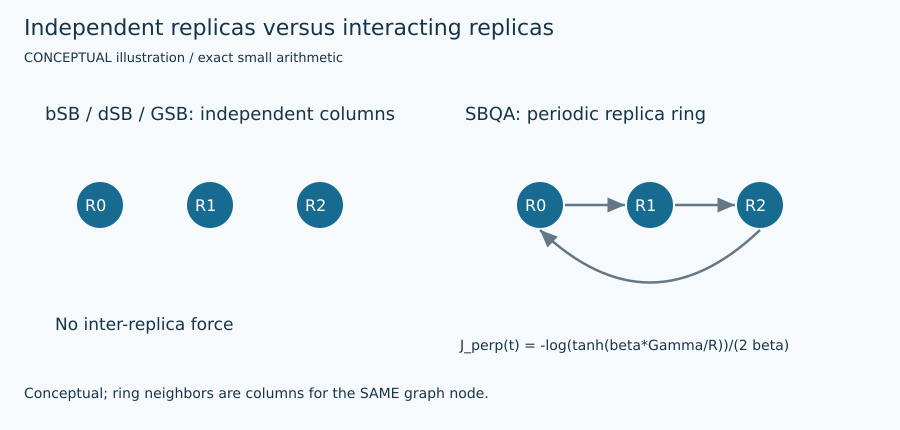

# Discrete simulated bifurcation

## 1. Problem and supported input

The target is original signed weighted Max-Cut: $F(s)=\sum_E w_{ij}(1-s_i s_j)/2$. Each edge is counted once; positive weights favor opposite signs and negative weights favor equal signs. Original node order is preserved. See [shared contract](ARCHITECTURE.md) and [objective/transformation details](MATHEMATICS.md). This method's actual availability, topology/size restrictions, warm-start use and work unit are exposed by `uv run python run_solver.py --solver dsb --features`.

## 2. Intuition

Use binary signs in the interaction force while positions and momenta remain continuous. This changes the force from bSB, not merely its final rounding.

## 3. Formulation and conventions

$y^{new}=y+\Delta t[-(1-a(t))x+c_0J\operatorname{sign}(x)]$; $x^{new}=x+\Delta t\,y^{new}$, followed by inelastic walls. During force evaluation sign(0)=0; final extraction maps zero to +1.

## 4. Algorithm steps

Initialize n×R independent columns near zero. For every momentum step use old coordinate signs in the weighted sparse field, then update positions with new momentum. Clip walls and clear their momenta. Independently score final replicas and optionally apply a separately reported bounded polish.

## 5. Fully worked small example

For the same +2 edge and x=(.1,−.2), c0=.5, dt=.1, J*sign(x)=(2,−2). Initial force is (.9,−.8), new y=(.09,−.08), and x=(.109,−.208). This differs from the bSB hand step while extracting the same cut 2.

[All required hand examples](MATHEMATICS.md#hand-worked-reference-instances) and [validation report](VERIFICATION.md) provide independent reference optima and original-format fixtures.

## 6. Illustration



Figures are labeled conceptual or measured. Numerical traces come from preserved tiny-run JSON/logs; arrows in conceptual diagrams are explanatory geometry, not measured backend events. [Regeneration and provenance](FIGURES.md).

## 7. Parameters and effects

replicas=8, dt=.25, a0=1, c0 auto RMS or explicit nonnegative value, polish=False. max_work=steps, seconds cooperative within integration; the CLI enforces a hard deadline.

Copyable config: [`configs/portfolio/dsb.json`](../../configs/portfolio/dsb.json). Do not supply unsupported options; they are rejected rather than silently ignored.

## 8. Complexity and memory

$O(nR+m)$ state and $O(steps\,(n+m)R)$ CPU work. Replicas are independent, unlike SBQA’s axis-one ring.

## 9. Exactness and certification limits

No global certificate or upper bound. Raw and polished output are separate; returning a warm incumbent stronger than the final replica is recorded through actual labels and raw_cut. Execution status, feasible assignment and optimality evidence remain separate. No serialized independently checked certificate is claimed by this portfolio.

## 10. Source-to-code mapping

portfolio_bifurcation.dynamics_step method dsb; Goto et al. 2021 Methods Eqs.(17)–(18), primary full HTML and local comments.

Primary source records: [`sb`](../../papers/README.md#sb). [External pins/builds](EXTERNAL_BUILDS.md) and [reading notes](SOURCE_REVIEW.md) distinguish obtained full text, unavailable PDFs, and inspected source code.

## 11. Run and interpret outputs

```bash
uv run python run_solver.py --solver dsb \
  --instance evidence/portfolio/shared_validation_final/inputs/trap.txt \
  --config configs/portfolio/dsb.json --seed 1 \
  --time-limit 10 --output runs/dsb_example_01
```

Choose a new suffix if the output already exists. Optional methods require their extras/source builds from [setup](EXTERNAL_BUILDS.md). Read `result.json` and actual `worker.log`/native logs; `solutions/<input basename>` is written only for validated labels. The tiny example has no professor reference score: official cut verification still runs, while reference score is null. `upper_bound=null` means no bound was computed, not zero gap. QuBowl deliberately returns unavailable with no assignment.

## 12. Implementation deviations

The implementation retains the distinct discrete force but uses project CPU defaults and endpoint ramp sampling; it does not reproduce FPGA throughput or claim all paper benchmarks.
