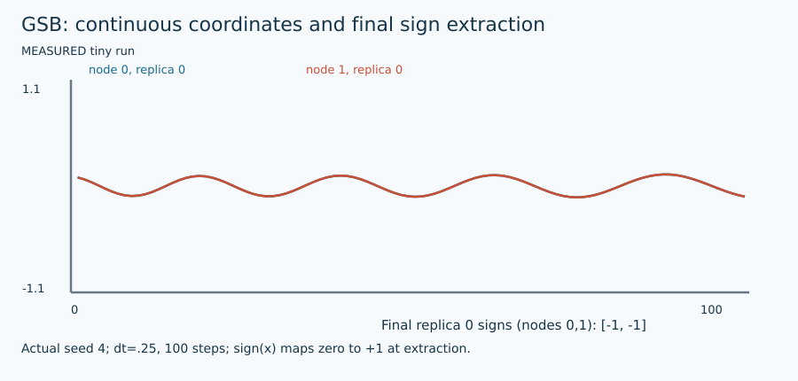

# Generalized ballistic simulated bifurcation

## 1. Problem and supported input

The target is original signed weighted Max-Cut: $F(s)=\sum_E w_{ij}(1-s_i s_j)/2$. Each edge is counted once; positive weights favor opposite signs and negative weights favor equal signs. Original node order is preserved. See [shared contract](ARCHITECTURE.md) and [objective/transformation details](MATHEMATICS.md). This method's actual availability, topology/size restrictions, warm-start use and work unit are exposed by `uv run python run_solver.py --solver gsb --features`.

## 2. Intuition

Give each oscillator its own evolving restoring parameter. Feedback from its position delays sticking to walls; strength A changes the nonlinear dynamics.

## 3. Formulation and conventions

$p_i^{new}=p_i-(1-Ax_i^2)p_i/(M-m)$; $y_i^{new}=y_i+\Delta t[-p_i^{new}x_i+c_0(Jx)_i]$; $x_i^{new}=x_i+\Delta t\,y_i^{new}$. Apply inelastic walls.

## 4. Algorithm steps

Initialize x independently at ±.1, y=0 and p=1 for every node/replica. Update p using old x first; update momentum using that NEW p and old x; update position with new momentum, then walls. Independently score final replicas.

## 5. Fully worked small example

With xA=.1, pA=1, A=1 and M=10 at m=0, pA becomes 1−.99/10=.901. For +2 AB with xB=−.2 and c0=.5, forceA=−.901*.1+.5*.4=.1099. At dt=.1, yA=.01099 and xA=.101099. Using old p would implement a different step.

[All required hand examples](MATHEMATICS.md#hand-worked-reference-instances) and [validation report](VERIFICATION.md) provide independent reference optima and original-format fixtures.

## 6. Illustration



Figures are labeled conceptual or measured. Numerical traces come from preserved tiny-run JSON/logs; arrows in conceptual diagrams are explanatory geometry, not measured backend events. [Regeneration and provenance](FIGURES.md).

## 7. Parameters and effects

nonlinear_strength=1, replicas=8, dt=.25, a0=1, c0 auto RMS or explicit. A=0 is a linear-pump ablation; denominator M−m stays >=1. Configuring A is not evidence of being at an edge of chaos.

Copyable config: [`configs/portfolio/gsb.json`](../../configs/portfolio/gsb.json). Do not supply unsupported options; they are rejected rather than silently ignored.

## 8. Complexity and memory

Three n×R arrays plus sparse graph: $O(nR+m)$ memory and $O(steps\,(n+m)R)$ CPU work. No eigendecomposition or dense n×n allocation is implicit.

## 9. Exactness and certification limits

Heuristic; no upper bound or claimed quantum speedup. Raw final replicas are independently evaluated. Optional local polish is explicitly a hybrid. Execution status, feasible assignment and optimality evidence remain separate. No serialized independently checked certificate is claimed by this portfolio.

## 10. Source-to-code mapping

portfolio_bifurcation.dynamics_step gsb implements published-formulation Eqs.(3)–(7), verified against arXiv:2508.17655v5 (Phys. Rev. Applied 25, 044011, 2026). Earlier v1 is retained separately.

Primary source records: [`gsb_published`](../../papers/README.md#gsb-published), [`gsb`](../../papers/README.md#gsb). [External pins/builds](EXTERNAL_BUILDS.md) and [reading notes](SOURCE_REVIEW.md) distinguish obtained full text, unavailable PDFs, and inspected source code.

## 11. Run and interpret outputs

```bash
uv run python run_solver.py --solver gsb \
  --instance evidence/portfolio/shared_validation_final/inputs/trap.txt \
  --config configs/portfolio/gsb.json --seed 1 \
  --time-limit 10 --output runs/gsb_example_01
```

Choose a new suffix if the output already exists. Optional methods require their extras/source builds from [setup](EXTERNAL_BUILDS.md). Read `result.json` and actual `worker.log`/native logs; `solutions/<input basename>` is written only for validated labels. The tiny example has no professor reference score: official cut verification still runs, while reference score is null. `upper_bound=null` means no bound was computed, not zero gap. QuBowl deliberately returns unavailable with no assignment.

## 12. Implementation deviations

Default c0 uses the project RMS scale; Appendix A recommends c=1/lambda_max, estimated for its random dense benchmarks or numerically found for G-set. Supply that value explicitly to reproduce those settings. CPU dt=.25/A=1 is an educational configuration, not an optimized benchmark or chaos-detection implementation. GSB schedule sampling differs from bSB endpoint sampling.
