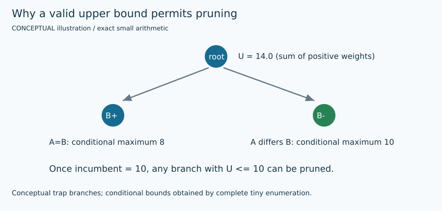

# ScientificMaxcutSolver exact integration

## 1. Problem and supported input

The target is original signed weighted Max-Cut: $F(s)=\sum_E w_{ij}(1-s_i s_j)/2$. Each edge is counted once; positive weights favor opposite signs and negative weights favor equal signs. Original node order is preserved. See [shared contract](ARCHITECTURE.md) and [objective/transformation details](MATHEMATICS.md). This method's actual availability, topology/size restrictions, warm-start use and work unit are exposed by `uv run python run_solver.py --solver scientific --features`.

## 2. Intuition

Runs the actual refined Max-Cut branch-and-cut solver and its own SCIP model, independently of the project XOR MILP.

## 3. Formulation and conventions

Original mc file has one-based nodes; SMS removes native dummy node 0 and compacts ascending IDs. Omit only zero-weight records because its parser rejects them; preserve all original isolates. JSON partition_0/partition_1 must cover all zero-based original nodes. No sign or factor change.

## 4. Algorithm steps

Validate supported input, seed, budgets and warm-start capability. Reserve a unique native artifact tree; write the inspected conversion and native parameters. Run the actual executable with owned-process timeout cleanup. Recover a real native witness; independently validate signs, direct original F and native primal agreement. Preserve raw logs, source pin, executable SHA, status and any computed bound.

## 5. Fully worked small example

On AB=4, BC=3, AC=−2, the recovered partition B versus AC has 4+3=7. Native primal and dual both 7 corroborate direct original F; zero-edge removal is checked on a disconnected fixture.

[All required hand examples](MATHEMATICS.md#hand-worked-reference-instances) and [validation report](VERIFICATION.md) provide independent reference optima and original-format fixtures.

## 6. Illustration



Figures are labeled conceptual or measured. Numerical traces come from preserved tiny-run JSON/logs; arrows in conceptual diagrams are explanatory geometry, not measured backend events. [Regeneration and provenance](FIGURES.md).

## 7. Parameters and effects

max_nodes=100000 adapter guard; max_work is native branch-node limit; seconds reaches --timelimit; seed <=2^31−1. A supplied incumbent is actually written as native partition JSON and passed with --warm-start-solution.

Copyable config: [`configs/portfolio/scientific.json`](../../configs/portfolio/scientific.json). Do not supply unsupported options; they are rejected rather than silently ignored.

## 8. Complexity and memory

Conversion is sparse O(n+m). Native SDP methods can use dense O(n²) matrices and expensive bound work; sparse exact/MQLib internal memory depends on its actual native algorithm. Conservative adapter guards do not predict practical runtime or avoid every native allocation.

## 9. Exactness and certification limits

SCIP primal/dual/status are parsed from actual raw output. optimal solution found plus successful exit and recovered witness supports solver_reported_optimal within upstream tolerances. Execution status, feasible assignment and optimality evidence remain separate. No serialized independently checked certificate is claimed by this portfolio.

## 10. Source-to-code mapping

external/ScientificMaxcutSolver/build-compat/sms; native CLParser, McSolution and BasicOcwSolver implement the reviewed interfaces.

Primary source records: [`scientific`](../../papers/README.md#scientific). [External pins/builds](EXTERNAL_BUILDS.md) and [reading notes](SOURCE_REVIEW.md) distinguish obtained full text, unavailable PDFs, and inspected source code.

## 11. Run and interpret outputs

```bash
uv run python run_solver.py --solver scientific \
  --instance evidence/portfolio/shared_validation_final/inputs/trap.txt \
  --config configs/portfolio/scientific.json --seed 1 \
  --time-limit 10 --output runs/scientific_example_01
```

Choose a new suffix if the output already exists. Optional methods require their extras/source builds from [setup](EXTERNAL_BUILDS.md). Read `result.json` and actual `worker.log`/native logs; `solutions/<input basename>` is written only for validated labels. The tiny example has no professor reference score: official cut verification still runs, while reference score is null. `upper_bound=null` means no bound was computed, not zero gap. QuBowl deliberately returns unavailable with no assignment.

## 12. Implementation deviations

The target SIAM PDF returned 403 and the author thesis was blocked by an access challenge. The adapter was grounded in full native source/CLI, not a claimed reading of unavailable papers. Build uses a standard-header compiler wrapper; tracked upstream files remain unchanged.
