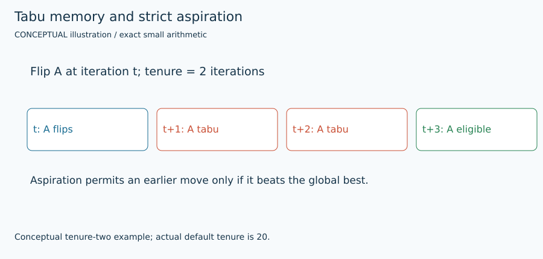

# Discrete one-flip tabu search

## 1. Problem and supported input

The target is original signed weighted Max-Cut: $F(s)=\sum_E w_{ij}(1-s_i s_j)/2$. Each edge is counted once; positive weights favor opposite signs and negative weights favor equal signs. Original node order is preserved. See [shared contract](ARCHITECTURE.md) and [objective/transformation details](MATHEMATICS.md). This method's actual availability, topology/size restrictions, warm-start use and work unit are exposed by `uv run python run_solver.py --solver tabu --features`.

## 2. Intuition

Allow temporary cut decreases to leave a local optimum, while short-term memory prevents immediately undoing a move. Keep global best separate.

## 3. Formulation and conventions

Choose an admissible maximum-gain flip using $g_i=s_i\sum_jw_{ij}s_j$. A tabu node is permitted only if $F(s)+g_i>F_{best}$; worsening admissible moves are allowed.

## 4. Algorithm steps

Initialize copied current/best labels and gains. At iteration t, combine expiry and strict aspiration; uniformly break equal-gain ties. Flip the best admissible node, update gains with its old sign, set expiry=t+tenure+1, and directly verify any claimed best gain. If all nodes are tabu, count a wait.

## 5. Fully worked small example

The trap AB|CD has F=8 and all gains −1. Flipping A reaches 7; flipping D then reaches 10. The measured seed-7, tenure-1 run does this while its saved best remains at least 8. Returning to a lower exploratory cut later never replaces 10.

[All required hand examples](MATHEMATICS.md#hand-worked-reference-instances) and [validation report](VERIFICATION.md) provide independent reference optima and original-format fixtures.

## 6. Illustration



Figures are labeled conceptual or measured. Numerical traces come from preserved tiny-run JSON/logs; arrows in conceptual diagrams are explanatory geometry, not measured backend events. [Regeneration and provenance](FIGURES.md).

## 7. Parameters and effects

tenure=20 counts iterations, including waits. tenure=0 is an explicit ablation. restart_after=0 disables random stagnation restarts; positive values restart current after that many non-improving iterations and retain best. max_work counts iterations.

Copyable config: [`configs/portfolio/tabu.json`](../../configs/portfolio/tabu.json). Do not supply unsupported options; they are rejected rather than silently ignored.

## 8. Complexity and memory

$O(n)$ best-admissible scans plus $O(deg(i))$ gain updates per accepted move; sparse $O(n+m)$ memory. History is capped at 200 events.

## 9. Exactness and certification limits

Heuristic only, even if it finds the tiny oracle optimum. It computes no upper bound. Seed reproducibility applies to equal work, not noisy wall-time termination. Execution status, feasible assignment and optimality evidence remain separate. No serialized independently checked certificate is claimed by this portfolio.

## 10. Source-to-code mapping

portfolio_search.solve_tabu and bm_solver.flip_node. Palubeckis–Krivickiene 2004 provides the one-flip tabu/aspiration reference; actual rules are explicitly specified here.

Primary source records: [`tabu`](../../papers/README.md#tabu). [External pins/builds](EXTERNAL_BUILDS.md) and [reading notes](SOURCE_REVIEW.md) distinguish obtained full text, unavailable PDFs, and inspected source code.

## 11. Run and interpret outputs

```bash
uv run python run_solver.py --solver tabu \
  --instance evidence/portfolio/shared_validation_final/inputs/trap.txt \
  --config configs/portfolio/tabu.json --seed 1 \
  --time-limit 10 --output runs/tabu_example_01
```

Choose a new suffix if the output already exists. Optional methods require their extras/source builds from [setup](EXTERNAL_BUILDS.md). Read `result.json` and actual `worker.log`/native logs; `solutions/<input basename>` is written only for validated labels. The tiny example has no professor reference score: official cut verification still runs, while reference score is null. `upper_bound=null` means no bound was computed, not zero gap. QuBowl deliberately returns unavailable with no assignment.

## 12. Implementation deviations

This is a project best-admissible fixed-tenure variant, not the reference paper’s full transformed-QUBO MST/RRT procedure with aspirational descent. Optional fixed stagnation restarts are a project extension.
