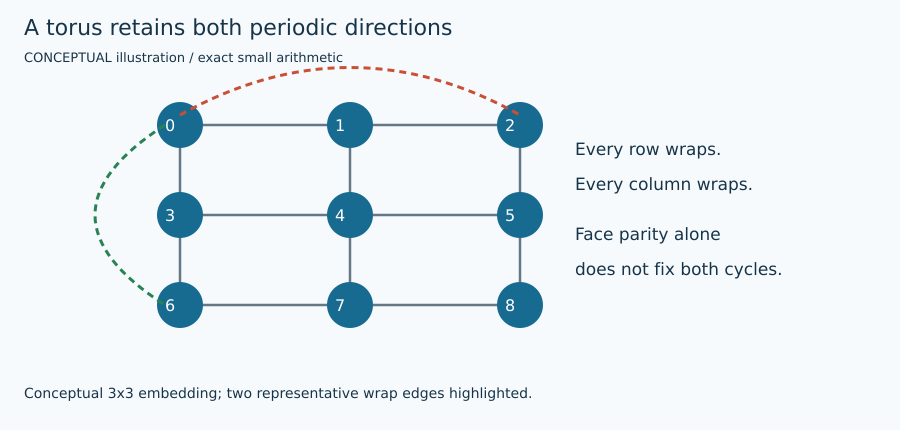

# Toroidal face-parity upper bound

## 1. Problem and supported input

The target is original signed weighted Max-Cut: $F(s)=\sum_E w_{ij}(1-s_i s_j)/2$. Each edge is counted once; positive weights favor opposite signs and negative weights favor equal signs. Original node order is preserved. See [shared contract](ARCHITECTURE.md) and [objective/transformation details](MATHEMATICS.md). This method's actual availability, topology/size restrictions, warm-start use and work unit are exposed by `uv run python run_solver.py --solver toroidal_bound --features`.

## 2. Intuition

Compute the optimal value of a local consistency relaxation and separately reconstruct feasible signs. The relaxation can violate global torus cycles.

## 3. Formulation and conventions

$F(s)\le F^*\le U$. Preferred/violated edge relations yield a matching bound on elementary face consistency, but do not enforce both noncontractible cycle constraints.

## 4. Algorithm steps

Verify n=L² with L>=3 and every original right/down periodic edge in row-major coordinates, including both wraps. Use exact integer scaling and the pinned upstream expanded-dual/matching primitives. Convert the matching value to U, reconstruct a candidate by BFS, and directly score original signs. Retain any stronger warm incumbent.

## 5. Fully worked small example

The preserved signed 3×3 fixture has exhaustive optimum 8 and matching relaxation U=9. The adapter’s feasible witness has cut 8. Remaining gap is 1; the relaxation’s extra unit is not a feasible cut or a proof that 9 can be attained.

[All required hand examples](MATHEMATICS.md#hand-worked-reference-instances) and [validation report](VERIFICATION.md) provide independent reference optima and original-format fixtures.

## 6. Illustration



Figures are labeled conceptual or measured. Numerical traces come from preserved tiny-run JSON/logs; arrows in conceptual diagrams are explanatory geometry, not measured backend events. [Regeneration and provenance](FIGURES.md).

## 7. Parameters and effects

max_expanded_nodes=4096 limits the expanded matching graph; default covers side<=32. max_stall=10 belongs to the paired search controller and has no effect on a bound-only call. max_work has no additional repair iterations for this method: the initial bound computation is always one matching when time permits.

Copyable config: [`configs/portfolio/toroidal_bound.json`](../../configs/portfolio/toroidal_bound.json). Do not supply unsupported options; they are rejected rather than silently ignored.

## 8. Complexity and memory

Expanded dual has 4n vertices and sparse lattice edges, but NetworkX blossom has high polynomial time and Python overhead. This is a small/medium topology path, not permission to run 100000-node dense matching.

## 9. Exactness and certification limits

U is a computed integer local-relaxation bound under verified embedding/matching assumptions. Only direct feasible equality with U earns solver-reported optimality. A gap leaves status unproven. Execution status, feasible assignment and optimality evidence remain separate. No serialized independently checked certificate is claimed by this portfolio.

## 10. Source-to-code mapping

portfolio_topology.torus_faces / solve_toroidal; pinned toroid_lp_lib.build_expanded_dual, match_expanded_dual and paint_nodes_bfs. Glass–Feder 2026 and global-cycle literature were read.

Primary source records: [`toroidal`](../../papers/README.md#toroidal), [`domain_walls`](../../papers/README.md#domain-walls). [External pins/builds](EXTERNAL_BUILDS.md) and [reading notes](SOURCE_REVIEW.md) distinguish obtained full text, unavailable PDFs, and inspected source code.

## 11. Run and interpret outputs

```bash
uv run python run_solver.py --solver toroidal_bound \
  --instance evidence/portfolio/shared_validation_final/inputs/torus.txt \
  --config configs/portfolio/toroidal_bound.json --seed 1 \
  --time-limit 10 --output runs/toroidal_bound_example_01
```

Choose a new suffix if the output already exists. Optional methods require their extras/source builds from [setup](EXTERNAL_BUILDS.md). Read `result.json` and actual `worker.log`/native logs; `solutions/<input basename>` is written only for validated labels. The tiny example has no professor reference score: official cut verification still runs, while reference score is null. `upper_bound=null` means no bound was computed, not zero gap. QuBowl deliberately returns unavailable with no assignment.

## 12. Implementation deviations

The adapter calls sparse reviewed primitives instead of upstream HAPI, which densifies. L=2 aliases parallel periodic edges and is rejected. Nothing deletes wraps to invoke planar solving. Resource guards can yield unavailable status on larger tori.
