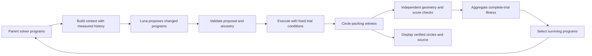

# Circle packing as an evolutionary-search classroom task

Design option, November 2, 2026. **Not implemented or numerically benchmarked.**
Read [the redesign handoff](../DEMO_REDESIGN_HANDOFF.md) for the active task,
cross-tutorial propagation and the zero-new-model-call boundary.

## 1. The teaching perspective

Keep the focus on evolving a **packing algorithm**. The circles on screen are
the output used to evaluate that algorithm. The evolutionary population contains
solver programs, not merely a gallery of circle arrangements.

The central sentence for students is:

> Luna proposes a change to a packing algorithm. We execute the changed algorithm,
> independently check the resulting packing, and use its measured quality to
> decide which programs survive.

This is connected to a real program-evolution example: the 2025 AlphaEvolve
report describes packing variable-radius circles in a unit square under a
sum-of-radii objective (Appendix B.12). It also describes evolving search
heuristics rather than only the constructions they return. This is a conceptual
precedent, not evidence that this classroom prototype will reproduce its results.
[Primary report](https://storage.googleapis.com/deepmind-media/DeepMind.com/Blog/alphaevolve-a-gemini-powered-coding-agent-for-designing-advanced-algorithms/AlphaEvolve.pdf).

## 2. Choose exactly one mathematical problem

Recommended first option: fix a circle count `N`, place circles with variable
radii inside the unit square, and maximize the sum of radii:

\[
\max_{x_i,y_i,r_i}\quad S=\sum_{i=1}^N r_i
\]

subject to

\[
r_i\ge0,\qquad
r_i\le x_i\le1-r_i,\qquad
r_i\le y_i\le1-r_i,
\]

\[
\sqrt{(x_i-x_j)^2+(y_i-y_j)^2}\ge r_i+r_j
\quad\text{for every }i<j.
\]

Tangency is allowed. The score is **sum of radii**, not occupied area
`pi * sum(r_i**2)`. An equal-radius packing that maximizes a common radius is a
different problem; do not mix its score or references with this formulation.

Zero radii are feasible under the displayed definition. Report their count. If
the course instead requires `N` strictly positive circles, declare a positive
minimum radius in the instance contract and recheck references accordingly.

Begin with `N=26` as a candidate because of the literature connection, then
screen smaller counts if needed for bounded runtime and visible differences.
Do not select a size solely to manufacture a successful live trajectory. A
fixed `N` shared across the three concept experiments helps isolate their changes.

## 3. Map the five framework components

| Chapter 10 component | Circle-packing interpretation |
| --- | --- |
| Artifact space `A` | Bounded solver recipes, or a deliberately chosen alternative of executable heuristic functions |
| Fitness `f` | Negative median verified sum of radii across the prescribed complete trials; feasibility is mandatory |
| Mutation `mu` | Luna receives parent programs and the allowed context, then proposes changed programs |
| Selection `sigma` | Declared selection from comparable parents and children; retain the incumbent under that protocol |
| Initial population `P0` | Complete, disclosed initial solver programs selected before the first mutation |

One numerical trial produces a witness `[(x_i,y_i,r_i)]`. A packing score belongs
to that witness; program fitness aggregates trials. A random seed controls numeric
starts and stochastic moves, not which initial algorithm is checked or which
words Luna generates.



## 4. Decide what Luna is allowed to change

### Option A — bounded recipes: closest to the current implementation

Implement trusted circle-packing methods locally. Luna returns their identifiers,
bounded parameters, stage order, work limits and start rules. It can change a
search schedule or composition; it does not write new numerical kernels.

An initial implementation can expose mechanisms such as:

- **Local Center Search:** perturb selected centers, recompute radii, accept a
  verified improvement, retain the incumbent.
- **Simulated Annealing of Centers:** allow bounded temporary losses under a
  disclosed temperature schedule while retaining the best verified packing.
- **Multiscale Center Perturbation:** change move scale or subset size after
  stagnation, followed by local search.

These names describe proposed methods to implement and benchmark. They are not
already present in this repository, and none is yet established as best.
Do not reuse Max-Cut algorithm names to label unrelated geometry operations.

For fixed centers, radius allocation has a useful simple subproblem. Let
`d_ij` be the center distance and
`u_i=min(x_i,1-x_i,y_i,1-y_i)`. Maximize `sum(r_i)` subject to
`r_i+r_j <= d_ij` and `0 <= r_i <= u_i`. Those are linear constraints in the
radii because the centers are fixed. This does not solve the full nonconvex
center-placement problem.

One implementation candidate is `scipy.optimize.linprog` with `c=-ones(N)`,
the pairwise upper-bound constraints, and the wall bounds. SciPy documents this
linear-program interface and HiGHS methods, including time-limit status.
[Official documentation](https://docs.scipy.org/doc/scipy/reference/optimize.linprog-highs.html).
Add SciPy to the student dependencies only after choosing and testing a compatible
version; it is not in the current requirements.

Use the same radius-allocation procedure in the initial programs and all proposal
conditions. Count its calls and time. After each center change, recompute radii
and independently validate the final witness before accepting its score. Temporary
rejected moves may exist internally; they must not appear as verified improvements.

### Option B — generated heuristic source: a different engineering scope

Luna could instead return a changed Python heuristic function or a patch to an
explicitly editable function body. This would make actual source evolution visible.
Define its input/output signature, allowed library access and budget enforcement
before implementing it. Keep the objective and geometry checker outside the
editable code. Show the real code change, compilation/validation outcome and trials.

The current owned subprocess supplies cancellation, **not a sandbox for arbitrary
LLM-generated code**. Source evolution requires an execution boundary with no API
keys, disabled network access, restricted filesystem access and resource limits.
AST checks alone do not provide that isolation. Do not enable this path merely
by calling `exec` on a response in the existing server or evaluator process.

The user must choose which representation the class should demonstrate. Option A
is the smaller extension; Option B shows a broader kind of program evolution.
Neither should be described as the other.

## 5. Concrete proposal and execution flow

For Option A, define a new task-specific schema rather than sending geometry
through the existing Max-Cut stage schema. Suggested envelope fields:

- `task_kind`, `schema_version`, `round_id`, `origin`;
- actual `parent_ids` for a mutation, or an empty list for independent generation;
- a testable `hypothesis`, bounded `children`, and an optional `plateau_reason`;
- stages with method, complete configuration, work cap and fresh/retained rule.

Illustrative recipe, **not a recorded response or currently accepted API payload**:

```json
{
  "task_kind": "circle_packing",
  "schema_version": 1,
  "round_id": 1,
  "origin": "mutation",
  "parent_ids": ["<selected-program-id>"],
  "hypothesis": "A larger perturbation after stagnation may find a better packing.",
  "children": [
    {
      "stages": [
        {
          "method": "local_center_search",
          "config": {"step_scale": 0.02, "subset_size": 1},
          "max_work": 40,
          "fresh": false
        },
        {
          "method": "multiscale_center_search",
          "config": {"step_scale": 0.06, "subset_size": 3},
          "max_work": 60,
          "fresh": false
        }
      ]
    }
  ],
  "plateau_reason": null
}
```

The server would validate the recipe and call prewritten geometry methods in
order. For retained stages, the next method receives the best verified packing
within that trial. Both stages share the trial allowance. A replacement-only
solver begins from the same prescribed trial starts as its competitors.

The proposed method names, work units, ranges and defaults must be implemented
before this example can execute. No fitness number or answer-coordinate array
is accepted from Luna as authoritative output.

## 6. Freeze a robust evaluation contract before tuning

**Inputs and starts.** Include `N`, unit-square dimensions, objective, minimum
radius policy, numerical tolerances and evaluator/executor versions in an instance
fingerprint. Generate disclosed feasible starts, for example a grid-based layout
with seeded perturbations and trusted radius allocation. Do not inject a published
optimized packing as a hidden answer. Use common copies for every competing program.

**Validity.** Require exactly `N` triples of finite real numbers. Reject wrong
shapes, NaN/infinity, negative radii, boundary violations and pairwise overlaps.
Check all pairs, not just visually nearby circles. Compute wall and pair gaps and
report the minimum margins and violation count. Independently sum the actual
returned radii; ignore a candidate's claimed objective or success flag.

**Numerics.** Select and record tolerance and any construction safety margin
before screening. A possible starting policy is validation tolerance `1e-9` in
unit-square units and a common conservative construction margin `1e-8`, to be
tested rather than assumed sufficient. Score and display the final returned
geometry after any declared construction step. No silent post-evaluation repair,
clipping, circle dropping or score-preserving shrinkage is permitted. Floating-point
validation is not a formal exact-arithmetic certificate.

**Work and completion.** Define work, for example one proposed center move plus
its radius-allocation call, and log solver initialization overhead as well. A
program completes when its declared bounded iteration/convergence rule is met;
an unexpected hard timeout, explicit interruption or required-stage failure is
incomplete. The validity of a returned incumbent is a separate field. Retain the
existing owned-process Stop/Reset behavior and hard whole-run deadline.

**Fitness and cost.** For complete trials, record sum of radii, minimum gap,
elapsed time, work count and completion. Aggregate the declared fitness across
three prescribed seeds, with explicit tie-breaks. Also show the best valid packing
found in any trial. Report model calls/tokens, numerical work and preparation cost
separately. Never average only the successful trials while quietly dropping failures.

**Reference.** Start without a numeric “best known” target if its objective,
constraints and provenance have not been verified. The literature is motivation,
not a cached answer or a classroom acceptance threshold. A higher verified score
is enough to illustrate improvement; matching a reference does not prove optimality.

## 7. Context and the three demonstrations

The request should contain selected program descriptions, their complete trial
results, relevant failures/duplicates, allowed methods and bounds, start semantics,
numeric and model budgets, and geometry summaries useful to the search. Examples
include stagnation, rejected overlap/boundary moves and accepted-improvement counts.
With recipe evolution, a full coordinate array usually need not be sent to Luna.
Do not include a known winning packing, private replay, API key or withheld tests.

Apply the same three concept questions from the main handoff:

1. Parent-conditioned versus independent packing-program generation.
2. Identical program inputs with structure-only versus evidence-rich context.
3. Complete-trial fitness and elitist selection, with visibly labeled invalid,
   worse or incomplete proposals where appropriate.

Circle packing supplies an intuitive fitness-design illustration. A valid example
has two circles at `(0.25,0.5)` and `(0.75,0.5)`, each of radius `0.25`, for sum
`0.5`. A claimed improvement with centers `(0.3,0.5)` and `(0.7,0.5)` and radii
`0.3` has sum `0.6`, but the center distance is `0.4` and the radii sum is `0.6`:
the circles overlap by `0.2`. The evaluator rejects it. These are instructor-made
toy examples, not model outputs or optimality claims.

Explain this as: **A larger score matters only after checking that the packing
satisfies the problem.** Follow immediately with the program/packing/fitness
distinction so the geometry does not become a disconnected optimization lecture.

## 8. Updated packings across generations: an explicit alternative

It is reasonable to let the next heuristic start from the best updated packing.
The AlphaEvolve report discusses that form of iterative construction refinement.
It is different from testing every algorithm from the original fixed starts.

For a fair warm-start comparison, freeze the same incoming packing bank for the
parent and child at that generation, account for the computation that created it,
and re-evaluate programs when the bank changes. Preserve state-bank identifiers.
Do not use scores obtained under different start banks as directly comparable
program fitness. A fixed validation bank can supply a separate stable measure of
algorithm quality, while the best-construction curve tracks cumulative progress.

Choose and label the protocol before the experiment; a random seed does not force
either choice. Do not silently turn the algorithm-focused tutorial into evolution
of a single coordinate vector.

## 9. Implementation work, in dependency order

1. Confirm problem variant and whether the artifact is a bounded recipe or source
   function. Approve no new model calls merely by choosing the domain.
2. Implement an independent geometry validator and a tiny valid/invalid example.
   Test tangency, overlap, wall violation, zero/negative radii, malformed arrays and
   nonfinite values. Establish a disclosed baseline.
3. Prototype trusted numerical search and feasible starts. Benchmark candidate
   values of `N`, work caps and seeds before choosing classroom settings. Verify
   actual completion time and avoid a ceiling that makes every method identical.
4. Add a small task adapter, for example `demo/problems/circle_packing.py`, and an
   explicit task selector. Keep Max-Cut's existing adapter and hashed snapshot.
   Shared controller behavior should delegate task-specific starts, schema, worker
   execution and scoring rather than inventing fake graph edges or cut values.
5. Version the proposal schema, genome identity, instance/evaluation protocol and
   run records. Add independent-origin ancestry and context conditions. Preserve
   old Max-Cut runs/replays without reinterpretation.
6. Replace the graph witness view for this task with a unit-square circle view.
   Use equal horizontal/vertical scales. Show only verified geometry as successful,
   with sum of radii, minimum gap, validity, trial/seed and source program. If a
   rejected proposal is illustrated, mark it invalid distinctly. Preserve both
   the latest displayed witness and the archived best.
7. Update algorithm examples, exact exchange, architecture/data-flow diagrams,
   student dependencies and setup; then propagate all narrative changes using
   the matrix in the main handoff. Rebuild and inspect browser/PDF exports.
8. Finish offline regression and real numerical worker checks. Only with a fresh
   allowance, rehearse real Luna requests, interruption and genuine replay. Measure
   whether each guided demo fits 3–5 minutes and the whole lecture fits 20–25.

Current Max-Cut couplings to inspect include `backend.instance_spec`,
`checked_labels`, `score_labels`, stage config validation, `proposals.SCHEMA`,
`controller.verify_result`/trial construction, graph-shaped server responses,
`app.js` sign validation/graph rendering, `/algorithms`, scenario metadata and
tests. Changing only a plot or prompt is not a circle-packing implementation.

## 10. First implementation milestone

A successful first milestone is **numerical-only**: a clean student checkout
starts the server, selects circle packing, executes two disclosed solver recipes,
shows valid packings and independently computed scores over common trial starts,
supports Stop/Reset, and leaves all old Max-Cut tests usable. No live-model claim
is made. Then implement the controlled mutation/context experiments and request
only the model-call budget needed for a concrete bounded rehearsal.
